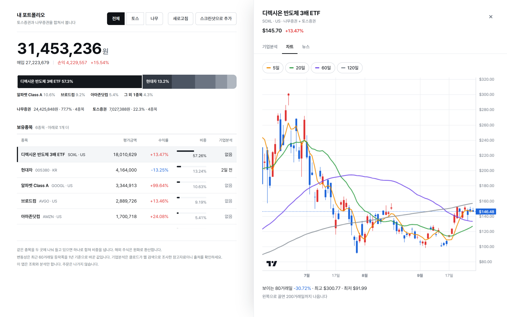
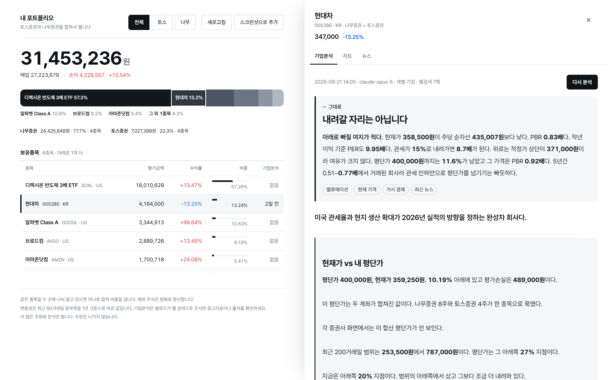

# 두 증권사를 합쳐서 보는 포트폴리오 분석기

[](https://github.com/younggeon03/stock-portfolio/actions/workflows/ci.yml)

토스증권과 나무증권 계좌를 하나로 합쳐 **실제 비중**을 계산하고, 공시 재무와 함께 종목을 정리하는 Spring Boot 서버입니다. 조회 전용이며 주문 기능은 없습니다. 개인 프로젝트로 혼자 설계·구현했습니다.

- **정확성** — 숫자는 앱이 계산하고, 틀린 값을 조용히 보여 주느니 실패를 드러냅니다(환율 실패 시 1,380배 오표시를 예외로 전환)
- **성능** — 공개 조회 동시 30명 p95 **8.8초 → 0.099초**, 처리량 5.2 → 53건/초(k6)
- **품질** — JUnit 테스트 239개, CI가 비밀값 없이 테스트·커버리지 최소선·도커 이미지 빌드까지 확인



> 스크린샷의 보유 종목·수량·평단가는 데모 데이터입니다. 시세·차트·공시 재무는 실제 값입니다.

## 왜 만들었나

증권사 앱은 자기 계좌만 보여 줍니다. 같은 종목을 두 곳에 나눠 들고 있으면 진짜 비중이 어디에도 안 보입니다.

| 보는 방식 | SOXL 비중 |
|---|---|
| 토스 앱에서만 | 2.98% |
| 나무 앱에서만 | 81.51% |
| **합치면** | **81.47%** |

토스 화면만 보면 "3%네, 더 사도 되겠다"가 됩니다. 실제로는 자산의 81%가 3배 레버리지 상품 하나에 몰려 있었습니다. 한쪽만 보면 정반대로 판단하게 됩니다. 이 앱은 이 숫자를 드러내려고 만들었습니다([개발일지](docs/개발일지.md)).

## 주요 기능

- 두 증권사 보유종목 합산과 실제 비중, 같은 종목 합치기, 해외주식 원화 환산
- 공시 재무(DART·SEC EDGAR) 3개년·최근 분기를 받아 PER·PBR·ROE를 앱이 직접 계산
- 일봉 캔들차트(이동평균선 네 개), 종목별 연환산 변동성, 종목 뉴스
- 기관 투자자 포트폴리오 공개 화면(SEC 13F, 인덱스를 뺀 큰 기관 10곳)과 배당 캘린더
- 장 마감 스냅샷과 증권사 합계 대사(0.1% 넘게 다르면 알림)
- 증권사 합산 해외주식 양도소득(남은 기본공제·예상 세액)
- 내 보유 상태를 반영한 기업분석(Claude + 웹 검색, 버튼을 눌러야만 실행)

기능별 동작 확인 상태는 [아키텍처 - 기능별 상태](docs/아키텍처.md#기능별-상태)에 있습니다.



## 아키텍처

```
 브라우저 (HTML·CSS·JS, 빌드 도구 없음)
    │  fetch · JSON
    ▼
┌──────────── Spring Boot :8080 (jar 하나) ────────────┐
│  web ── service (합산·비중·변동성·차트·기업분석)        │
│           │                                          │
│  brokerage (증권사 공통 규약)   external (바깥 API)     │
│    ├ 토스 ───────────────────► 토스증권 Open API       │
│    ├ 나무 ───────────────────► 나무증권 NAMUH PLUG     │
│    └ 직접 입력                 DART · SEC EDGAR · 13F  │
│                                Claude API (유료, 버튼)  │
└───────────────┬──────────────────────────────────────┘
                ▼
             MySQL (Flyway 마이그레이션)
```

- 브라우저는 바깥 API를 직접 부르지 않습니다. 키가 브라우저에 있으면 개발자 도구로 보이기 때문입니다.
- 보유종목은 저장하지 않고 매번 증권사에서 받습니다. 저장하는 것은 토큰, 직접 입력한 종목, 분석 결과, 공시 재무, 스냅샷 같은 기록입니다.
- 증권사는 `BrokerageClient` 인터페이스를 구현하고 `@Component`만 붙이면 늘어납니다. 비중·차트·분석 코드는 고치지 않습니다.
- 관리 포트(8081: 헬스체크·Prometheus)는 바깥에 열지 않습니다. readiness는 DB 연결까지 봅니다.

클릭해서 따라가는 전체 구조 그림은 [`docs/diagrams/architecture.html`](docs/diagrams/architecture.html)입니다(저장소를 받아 브라우저로 여세요). 계층·요청 흐름·DB는 [아키텍처](docs/아키텍처.md)에 있습니다.

## 설계에서 정한 것

되돌리기 어려운 판단은 [결정기록](docs/결정기록.md)에 22건으로 남겼습니다. 대표적인 것:

| 결정 | 이유 |
|---|---|
| [001 주문 API를 만들지 않는다](docs/결정기록.md#001-주문-api를-만들지-않는다) | 안 쓰는 것이 아니라 인터페이스에 주문 메서드를 정의하지 않습니다. 버그나 오타로도 돈이 움직일 수 없습니다 |
| [003 숫자는 앱이 계산하고 조사만 LLM에게](docs/결정기록.md#003-숫자는-앱이-계산하고-조사만-llm에게-맡긴다) | 수량·평단가·비중·재무는 앱이 계산해 프롬프트에 사실로 넣습니다. 모델은 웹에서 찾아야만 아는 것만 조사합니다 |
| [005 환율을 못 구하면 예외를 던진다](docs/결정기록.md#005-환율을-못-구하면-예외를-던진다) | `1`은 "모른다"가 아니라 "1달러는 1원"이라는 주장입니다. 틀린 화면보다 실패가 낫습니다 |
| [015 재시도는 GET과 5xx만, 서킷 브레이커는 호스트별](docs/결정기록.md#015-바깥-api-재시도는-get-과-5xx네트워크-오류에만-서킷-브레이커는-호스트별로) | 4xx는 다시 보내도 같고, POST는 두 번 실행될 수 있습니다. RestClient 인터셉터 한 곳에서 걸어 빠뜨릴 수 없게 했습니다 |
| [021 연결 설정을 기본값에 맡기지 않는다](docs/결정기록.md#021-연결-설정을-기본값에-맡기지-않는다) | 바깥 API 풀 하나(호스트당 8·전체 40), DB 소켓 타임아웃, 톰캣 keep-alive 60초 > Caddy 30초 |

## 기술 스택

| 영역 | 기술 | 쓴 곳 |
|---|---|---|
| 백엔드 | Java 21 · Spring Boot 3.3.5 · JPA · MySQL · Flyway | API, 배치, 마이그레이션 10개 |
| 바깥 연결 | RestClient + Apache HttpClient 5 · resilience4j | 타임아웃·재시도·호스트별 서킷 브레이커 |
| 외부 API | 토스증권 · 나무증권 NAMUH PLUG · DART · SEC EDGAR · Anthropic | 잔고·시세·공시 재무·13F·분석 |
| 프론트 | HTML · CSS · 바닐라 JS · Lightweight Charts | 화면이 표와 드로어뿐이라 프레임워크를 얹지 않음 |
| 테스트·CI | JUnit 5 · AssertJ · JaCoCo · GitHub Actions · k6 | 테스트, 커버리지 최소선, 부하 측정 |
| 배포·관측 | Docker Compose · GHCR · Caddy · Prometheus · Grafana · Alertmanager | 자동 배포·되돌림, 지표·알림(텔레그램) |

## 만들면서 부딪힌 문제

**1. 공개 조회가 동시 접속에 느려짐**
- 문제: k6로 30명을 붙이자 첫 화면 p95가 8.8초, 처리량 5.2건/초였습니다.
- 원인: "같이 산 종목"이 요청마다 기관 9곳 × 두 분기 보유(수만 줄)를 다시 비교해 한 번에 1.5~2초. 동시 요청이 줄을 섰습니다. 기관 상세 응답도 5천 줄을 통째로 보내 약 1MB였습니다.
- 해결: 13F 조회 결과를 메모리에 두고 **배치가 데이터를 바꿀 때만 비웁니다**(시간 만료가 없어 묵은 값을 줄 일이 없음). 상세는 위 100줄만 먼저 보냅니다(17KB).
- 결과: p95 **0.099초**, 처리량 53건/초, 실패 0%. 100명 스트레스에서 약 228건/초([운영 - 부하 테스트](docs/운영.md#부하-테스트)).

**2. 해외주식이 1,380배 작게 표시되는데 에러가 없음**
- 문제: 직접 입력한 미국 주식이 154,599원이 아니라 68원으로 보였습니다.
- 원인: 환율 조회가 실패하면 "앱이 죽지 않게" 기본값 1을 돌려주고 있었습니다. 해외 종목이 쪼그라들면서 국내 종목 비중이 전부 부풀었습니다.
- 해결: 환율을 못 구하면 계산을 멈추고 예외를 던져 화면에 이유를 띄웁니다([결정기록 005](docs/결정기록.md#005-환율을-못-구하면-예외를-던진다)).

**3. 업그레이드할 때마다 13초간 502**
- 문제: 배포 리허설에서 새 버전으로 바꾸는 동안 13초씩 502가 났습니다.
- 원인: 앱 컨테이너가 다시 뜨는 동안 앞단 Caddy가 받을 곳이 없었습니다.
- 해결: Caddy `lb_try_duration`으로 재시작 동안 요청을 최대 30초 잡아 둡니다. 뜨자마자 죽는 버전은 헬스체크가 잡아 바로 앞 버전으로 되돌립니다.
- 결과: 업그레이드 중 실패 응답 0, 깨진 버전은 실패 판정 24초 + 되돌림 13초 동안 실패 응답 0([운영 - 되돌리기](docs/운영.md#되돌리기)).

## 실행

```bash
git clone https://github.com/younggeon03/stock-portfolio.git
cd stock-portfolio
cp .env.example .env          # 증권사·DART·Anthropic 키를 채웁니다
docker compose up -d --build  # 앱 + MySQL → http://localhost:8080
```

- 토스는 허용 IP로 요청을 거릅니다. 토스 설정 화면에 지금 공인 IP를 등록해야 합니다(403이면 앱이 현재 IP를 알려 줍니다).
- API 문서는 코드에서 자동 생성됩니다: <http://localhost:8080/swagger-ui.html>
- 도커 없이 jar로 띄우는 법과 키 발급 순서는 [운영](docs/운영.md)에 있습니다.

## 테스트와 CI

```bash
./mvnw test   # 239개. 바깥 API·DB를 부르지 않아 키 없이 돕니다
```

- PR과 `main` 푸시마다 GitHub Actions가 테스트 → 커버리지 최소선 → jar → 도커 이미지 빌드를 돌립니다. 비밀값이 하나도 필요 없습니다.
- 커버리지 최소선은 계산 코드에만 겁니다(전체 38%, `external.filing` 75%, `service.analysis`·`service.stock`·`external.edgar` 60%, `external.dart` 45%). 키가 필요한 바깥 클라이언트까지 억지로 덮는 테스트는 쓰지 않습니다.
- `main` CI가 초록이면 배포 워크플로가 GHCR 이미지로 서버를 바꾸고, 헬스체크가 실패하면 앞 버전으로 되돌리도록 구성했습니다. 지금은 서버가 없어 배포 단계는 건너뜁니다.

## 한계

- **서버 상시 운영은 아직입니다.** 배포 스크립트·Caddy·관측 구성은 `deploy/`에 있고 내 PC 도커로 리허설했지만, 오라클 클라우드 가입이 막혀 고정 IP 서버를 아직 못 만들었습니다([로드맵](docs/로드맵.md)). 위 502·되돌림 수치는 리허설 결과입니다.
- 부하 측정은 앱과 k6가 같은 PC에서 돈 결과라 서버 수치와 다를 수 있습니다.
- Anthropic 크레딧이 없어 기업분석·판정은 파이프라인까지만 검증했습니다.
- 혼자 쓰는 규모에서 정한 풀·타임아웃 값입니다. 서버에 올린 뒤 지표를 보고 조정해야 합니다.

## 문서

| 문서 | 담는 것 |
|---|---|
| [아키텍처](docs/아키텍처.md) | 지금 구조: 서버 구성, 계층, 요청 흐름, 바깥 연동, DB, API 계약 |
| [결정기록](docs/결정기록.md) | 그때 왜 그렇게 정했나(22건) |
| [운영](docs/운영.md) | 실행, 테스트·CI, 배포, 관측, 장애 대응 |
| [개발일지](docs/개발일지.md) | 방향이 바뀐 지점의 회고 |
| [로드맵](docs/로드맵.md) | 아직 안 한 일 |
| [기술노트](docs/기술노트.md) | 이 저장소로 백엔드·DB·배포·인프라를 공부하는 노트 |

개인 프로젝트입니다. 투자 판단의 근거로 쓰라고 만든 것이 아닙니다.
